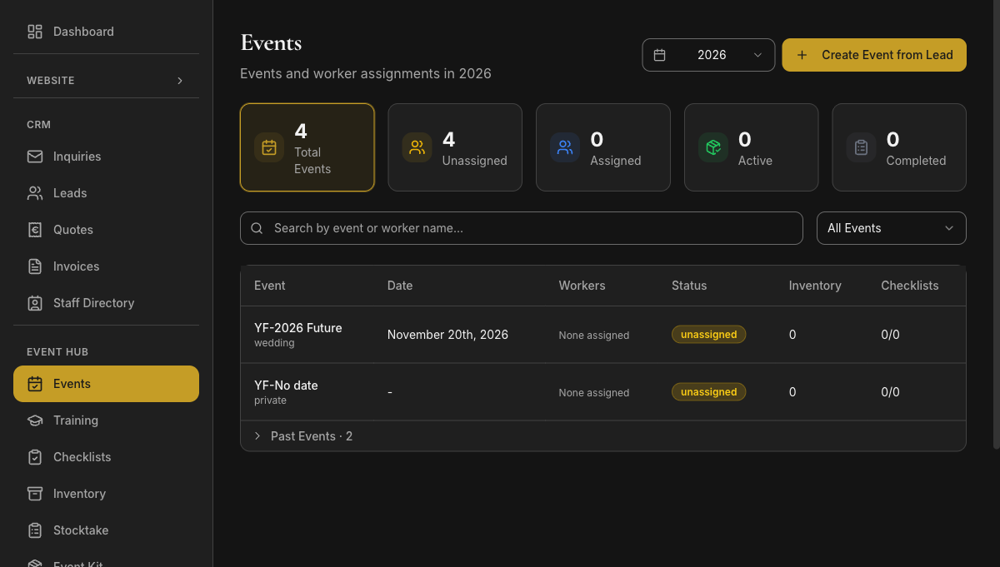
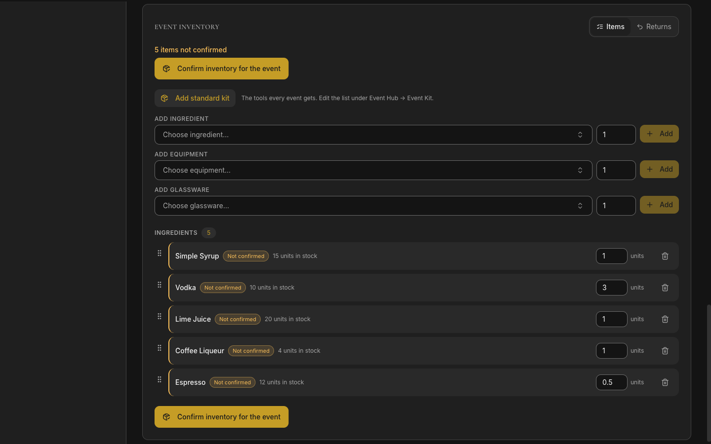

# ByJoseM: a custom operations platform for a premium bartending business

**Case study by Diego Bauer.** Design, build and delivery, solo, from 2025 to 2026.
This repository holds the write-up only. The ByJoseM software is private and no source code is published here.

*The Events hub in the admin. All screenshots in this repo use demo data from a local QA stack.*

---

## The client

ByJoseM is a premium mobile bartending service in Ireland: weddings, corporate events, private parties and cocktail masterclasses. The business grew faster than its tools.

Public site: [byjosem.com](https://www.byjosem.com)

## What the business needed

When we started, enquiries arrived through WhatsApp, phone, email and a basic website. Leads lived in a spreadsheet with no status and no follow-up dates. Quotes were typed by hand. Stock was counted from memory. When the owner was not at an event, there was no reliable way to hand a bartender the menu, the kit list and the standards for the night.

It needed one place that covered the whole job:

> enquiry, lead, quote, event, stock, staff, invoice, payment, receipt

and it had to be usable by one person on a phone, between events.

## Why off-the-shelf tools did not fit

I looked at the obvious stack: a website builder, a CRM, an invoicing app, an inventory app, a staff scheduling app. Each one is good at its own slice. Together they did not fit this business:

- **The job is one thread.** A booking starts as an enquiry and ends as a paid invoice, with a menu, a team and a van load of stock in between. Five tools meant five copies of the customer and no link between the quote, the event and the stock it consumed.
- **Bar inventory is its own discipline.** Generic inventory apps count products for sale. The business needs a weekly physical count, par levels, a reorder list, and stock that leaves for an event and partly comes back.
- **Staff are casual and phone-first.** Workers needed a login-free-feeling portal with their event, their checklist and the menu, and nothing else.
- **Cost and ownership.** A stack of per-seat subscriptions costs more each year than a small business wants to pay, and none of it would belong to the business.
- **The owner runs the business from a phone.** That shaped everything from number entry to how the manual is written.

So I built one platform, in the open-ended way small businesses actually grow: one real problem at a time, each shipped and then tested by the owner on real bookings.

## What I built

Three surfaces over one database.

**Public website.** Packages, services, experience cards, reviews, FAQs and an enquiry form, all edited by the owner from the admin. Enquiries become CRM leads automatically and trigger a customer confirmation email plus an internal notification. A public cocktail menu lets customers shortlist their three drinks and send the choice by WhatsApp without creating an account. It reads the same recipe records the staff use, so there is nothing to re-export when a drink changes.

**Admin CMS and CRM.** The owner's cockpit, about thirty pages.
- **Content management** for every section of the public site, with drag-and-drop ordering, a curated colour palette and icon set for package cards, and an image pipeline that resizes uploads in the browser.
- **CRM with a lead pipeline**: statuses, three follow-up dates, notes, event details, and an agreed price. A dashboard with a year filter, a follow-ups list for the next 48 hours, upcoming events, a confirmed-pipeline chart and a won/lost view of where enquiries went.
- **Quote generator**: packages priced flat, per guest, per hour or per cocktail, a free-form line editor for extras (two bartenders for four hours plus a waiter for five is six taps), travel fee helper, VAT inclusive or exclusive, and a branded PDF. Quotes can be saved as drafts, edited after sending with a revision number and a change history, duplicated, and converted into an invoice.
- **Invoices** with a legal numbering sequence assigned only at issue, drafts that never consume a number, issued invoices that cannot be deleted (void instead), payments recorded against one invoice per job, receipts with their own numbers, and derived Overdue and Part-paid states. A fix for sole traders: the registration number and VAT number are separate fields, and the VAT line only prints when the business is actually VAT-registered.
- **Stock management**: a mobile-first weekly stocktake in the order the owner walks the storeroom, par levels edited inline, a reorder list the owner can copy into WhatsApp or print, and a read-only count history.
- **Events hub**: assign staff with roles, attach checklists, choose the cocktail menu, and plan the event's stock. Adding items is a plan; one Confirm step is the only thing that moves warehouse stock, and later changes move only the difference. Returns are recorded per item or in one tap. Pre-event briefs and post-event reports print as PDFs, with prices off by default because staff read them.
- **Staff directory** with roles, availability and driving status, and one-click staff logins by email link.
- **A help centre**: fourteen articles written around the flow of a job, one tap from the admin header, rendered from markdown as part of the build so it cannot drift from its source.

**Worker portal.** Mobile-first. A worker sees only the events they are assigned to, with the menu (including measures and method), the checklists for their role, the event kit, and a start and complete clock. It also holds the training hub: videos, guides and checklists organised by category, with progress Jose can review.

## Outcomes the repo evidences

I am only listing what the project history can prove. No revenue claims.

- **Shipped continuously for a year.** 173 commits and over eighty merged pull requests across three versions, 80 database migrations, each one replayable from scratch on a local stack.
- **Built from the owner's feedback, not a spec written once.** Several live review sessions with the owner, each producing a numbered list; in the larger rounds every point was shipped or deliberately parked, usually within the same session or the next day.
- **One source of truth for prices.** The website, enquiry form, CRM, pipeline chart and quote builder were reading three different catalogues. A customer booking a masterclass could end up with the wrong package. After the rebuild, one catalogue and one pricing rule feed every surface.
- **The cocktail menu stopped being a 50 MB file sent over WhatsApp.** It became a page of about 390 KB, because photos are served as resized WebP instead of the original PNGs.
- **Homepage image weight dropped from 3.1 MB to 0.7 MB** after resizing uploads in the browser and serving every thumbnail through a resize transform.
- **Accessibility measured, not assumed.** A contrast script over the design tokens went from 9 failing pairs to 0. 66 icon-only buttons got a tooltip and an accessible name (33 had none). The event page went from 7 axe violations to 0.
- **Money handled in integer cents with server-side totals**, and a locale-safe number parser covered by unit tests. The project now has over 180 unit tests across the money, pricing and stock logic, plus written QA matrices and verification notes for each major change.

## Stack

| Layer | Choice |
|---|---|
| Frontend | React 18, TypeScript, Vite, installed as a PWA |
| UI | shadcn/ui on Radix primitives, Tailwind CSS |
| Data fetching | TanStack Query |
| Forms | React Hook Form with Zod |
| Backend | Supabase: Postgres, Auth, Storage, Row Level Security, edge functions |
| Documents | react-pdf for quotes, invoices, receipts and event briefs, loaded only in the admin |
| Charts | Recharts |
| Drag and drop | dnd-kit |
| Calendar | react-big-calendar |
| Email | Transactional email provider on the business's own domain |
| Testing | Vitest for logic, Playwright and axe for flows and accessibility |
| Delivery | Static hosting, with CI running a type check, the unit tests and a production build on every pull request |

## Screenshots

All captured on a local QA stack with seeded demo data. No real customers, prices or recipes appear.

| | |
|---|---|
|  |  |
| Public cocktail menu. A seasonal section leads the list only while seasonal drinks are switched on, under a title the owner sets. | Event inventory is a plan. Nothing leaves the warehouse until it is confirmed. |
|  | |
| The confirm step shows exactly what will move before anything moves. | |

More shots are listed in [docs/screenshots/TODO.md](docs/screenshots/TODO.md).

## Read more

- [Architecture](docs/architecture.md): surfaces, data model and roles, with diagrams
- [Security](docs/security.md): how access is enforced and verified
- [Decisions](docs/decisions.md): eight decisions and their tradeoffs
- [Lessons](docs/lessons.md): what I learned

---

Published with the permission of ByJoseM. Case study text copyright (c) 2026 Diego Bauer. See [LICENSE](LICENSE).
