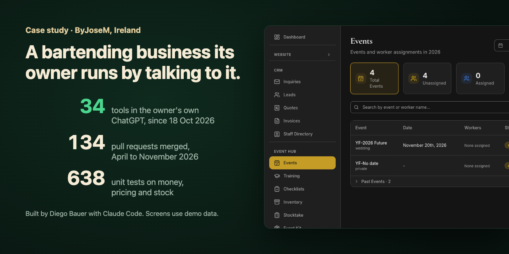
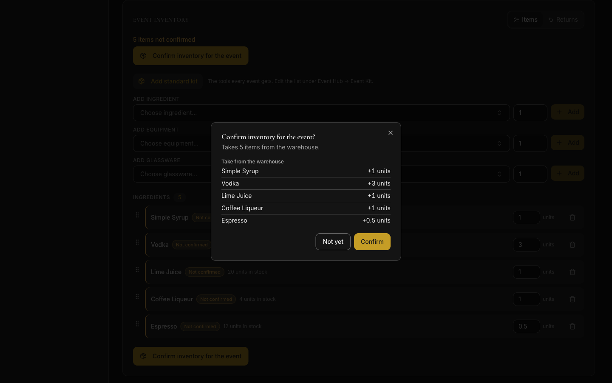
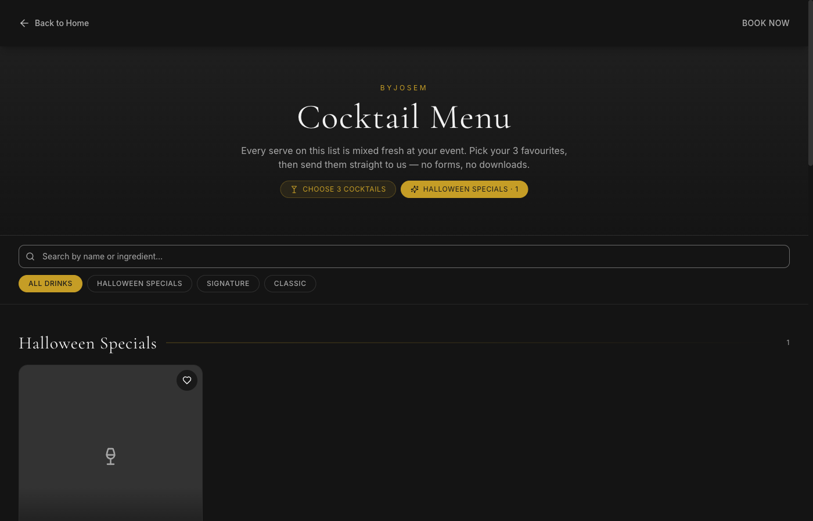

# ByJoseM case study

**A bartending business its owner now runs by talking to it.**

[](#the-problem)
[](#what-it-does)
[](https://github.com/AIwithDiego/byjosem-case-study/actions/workflows/ci.yml)


[](LICENSE)

[](#talk-to-your-business)

A case study of client work. Built by Diego Bauer for ByJoseM, a premium mobile bartending service in Ireland, from October 2025 to November 2026, with Claude Code. It started as a website and a back office. A year later the owner runs the business by voice from his own ChatGPT, through a connector into that back office. The platform is live and in daily use; the software is private, so this repo holds the story, the decisions and screenshots made with demo data.

**[Talk to your business](#talk-to-your-business)** · **[See the screens](#what-it-does)** (demo data, nothing real) · [Read the decisions](docs/decisions.md) · [Architecture](docs/architecture.md) · [Security](docs/security.md) · [byjosem.com](https://www.byjosem.com)

**Contents:** [The problem](#the-problem) · [Research](#research) · [What it does](#what-it-does) · [Talk to your business](#talk-to-your-business) · [Results](#results) · [The build](#the-build) · [What went wrong](#what-went-wrong) · [What I learned](#what-i-learned) · [Read more](#read-more)

## The problem

ByJoseM does weddings, corporate events, private parties and cocktail masterclasses. The business grew faster than its tools. When we started:

- **Enquiries came in everywhere:** WhatsApp, phone, email and a basic website form.
- **Leads lived in a spreadsheet** with no status and no follow-up dates.
- **Quotes were typed by hand,** and so were invoices.
- **Stock was counted from memory.**
- **The drinks menu went to customers as a file of about 50 MB** over WhatsApp.
- **When the owner wasn't at an event,** there was no reliable way to hand a bartender the menu, the kit list and the standards for the night.

One booking is one thread: enquiry, lead, quote, event, stock, staff, invoice, payment, receipt. The owner runs all of it from a phone, between events.

> Small businesses glue five apps together and copy the customer into each one. We built one thread the owner can run from a phone.

## Research

**What already exists.** The obvious stack: a website builder, a CRM, an invoicing app, an inventory app, a staff scheduling app. Each is good at its own slice. Together they meant five copies of the customer and no link between the quote, the event and the stock it used. Generic inventory apps count products for sale; a mobile bar needs a weekly count, par levels, a reorder list, and stock that leaves for an event and partly comes back. And a stack of per-seat subscriptions costs more each year than a small business wants to pay, with none of it belonging to the business.

**Who it's for.** One owner, an ex-bartender, working from a phone. Then casual staff who need their event, their checklist and the menu, and nothing else. Every screen is judged on a phone first, and the help centre is written around the flow of a job, not the list of screens.

**The limits we chose.**

1. **The database is the boundary.** No custom server. Row level security decides who sees what, and money and stock change only through database functions that recompute totals themselves.
2. **One catalogue, one price, one pricing rule** feed the website, the enquiry form, the CRM and the quote builder.
3. **Documents freeze what they were.** A quote or invoice keeps its lines, prices and business details as written; changing settings never rewrites a document a customer already has.
4. **Workers never see prices,** and only see the events they're assigned to.
5. **Built one real problem at a time,** each shipped and then tested by the owner on real bookings, not from a spec written once.

**What I didn't build.**

| Choice | Why | Trade-off |
|---|---|---|
| A weekly count and par levels, not stock worked out from recipes | Recipe-based usage only pays off when compared against till data, and there is no till | No automatic usage estimate; numbers drift until the next count ([decision 1](docs/decisions.md#1-kill-the-recipe-driven-inventory-engine-count-bottles-instead)) |
| One invoice per job with payments against it, not deposit and balance invoices | The owner needs to know who still owes money, not a filing structure | Receipts became their own numbered documents ([decision 6](docs/decisions.md#6-one-invoice-per-job-reversing-our-own-earlier-call)) |
| A custom platform, not five subscriptions | One thread from enquiry to receipt, owned by the business | Someone has to maintain it |
| No automation tool in the middle | The first version sent notifications through one; the enquiry function now sends them itself, one less service to pay for and watch | Changes need a developer, not a drag-and-drop editor |

## What it does

Three surfaces over one database, plus the ChatGPT connector added in October 2026.

| Surface | Who | What it does |
|---|---|---|
| **Public website** | Customers | Packages, services, reviews, FAQs and an enquiry form, all edited by the owner. Enquiries become CRM leads automatically. A cocktail menu lets customers shortlist three drinks and send the choice by WhatsApp, no account needed. |
| **Admin** | The owner | 32 pages: content, CRM and pipeline, quote builder with branded PDFs and revisions, invoices, payments and receipts, weekly stocktake and reorder list, events hub, staff directory, training, and a help centre of 14 articles. |
| **Worker portal** | Staff | Their assigned events only: the menu, the checklists for their role, the event kit, a start and complete clock, and a training hub. |
| **ChatGPT connector** | The owner | The owner runs the business by talking to it in his own ChatGPT: asks, acts and drafts, by voice. [More below](#talk-to-your-business). |

<table>
<tr>
<td width="50%"></td>
<td width="50%"></td>
</tr>
<tr>
<td>Event stock is a plan. Nothing leaves the warehouse until it's confirmed.</td>
<td>The confirm step shows exactly what will move before anything moves.</td>
</tr>
<tr>
<td width="50%"></td>
<td width="50%"></td>
</tr>
<tr>
<td>The public cocktail menu replaced a 50 MB file. A seasonal section leads only while seasonal drinks are on.</td>
<td>The Events hub: assign staff, attach checklists, choose the menu, plan the stock.</td>
</tr>
</table>


1. **Enquiry to lead** ([architecture](docs/architecture.md#surfaces)): the form goes through a server-side function that stores it, emails the customer and notifies the owner; a database trigger turns it into a lead.
2. **Quote** ([decisions 2, 3, 5](docs/decisions.md)): one catalogue with five pricing modes, a line editor for extras (two bartenders for four hours plus a waiter for five is six taps), a branded PDF, revisions with a change history, and one tap to turn it into an invoice.
3. **Event** ([decision 7](docs/decisions.md#7-event-stock-is-a-plan-you-confirm-not-instant-movements)): staff with roles, checklists, the cocktail menu, and stock as a plan. Each cocktail adds its own ingredients; removing it takes exactly those off. Briefs and reports print as PDFs, with prices off by default.
4. **Invoice and payments** ([decisions 2 and 6](docs/decisions.md#6-one-invoice-per-job-reversing-our-own-earlier-call)): a legal number assigned only at issue, issued invoices that can be voided but never deleted, payments against one invoice per job, a numbered receipt for each.
5. **Stock** ([decision 1](docs/decisions.md#1-kill-the-recipe-driven-inventory-engine-count-bottles-instead)): a weekly count in the order the owner walks the storeroom, par levels edited inline, a reorder list to copy into WhatsApp.
6. **Access** ([security](docs/security.md)): two roles, checked in the database and again in the interface. Workers read an event only while assigned to it.

## Talk to your business

By autumn 2026 the platform did its job: one thread from enquiry to receipt, tested on real bookings. It had replaced five apps and a spreadsheet. What it hadn't replaced was the owner's time at a screen. Jose was still spending a good part of his week inside the admin, on a phone, between events. A better back office would only have made that time a little shorter.

So the last layer wasn't another screen. Jose already used ChatGPT, so the business went there instead of the other way round. Since 18 October 2026 the platform has a connector (an MCP server) in his own ChatGPT account. By mid-November he was running the day-to-day by voice: he says what he needs, and ChatGPT does it in the back office.

| He can | Through |
|---|---|
| **Ask** what's on this month, who still owes money, which leads have gone quiet, what's running low, who's free on Saturday, how the month compares to last | 16 read tools: events, leads, enquiries, quotes, money outstanding, stock, staffing, business summary, package performance, repeat customers |
| **Do** add or update a lead, plan an event's cocktails, staff and standard kit, record a delivery, confirm the stock leaving for an event and log what came back | 15 write tools, each logged, with an undo for stock and lead changes |
| **Draft** a quote from the real catalogue and prices, or a reply to a customer | 3 draft tools; drafts are saved in the admin and nothing is sent |

**How it talks.** The rule I wrote before the first tool: Jose should feel he is talking to his business, not filling in forms. A question gets one answer and no follow-up questions. A job with several details, like organising an event, is a conversation that offers the real options from his own catalogue. Only sensitive changes ask first: saving a quote or an invoice. Closing a lead goes straight through, because Jose tried both and preferred it. When something can't be done from ChatGPT yet, it says so and says where to do it in the admin.

**How it stays safe.** It connects through his own account but only reaches its own 34 functions in a separate database schema, never the admin's, so a stolen token can do what the tools do and nothing more. It never sends anything to a customer, deletes anything or touches payments. Text typed by customers comes back marked as untrusted. Stock leaving or coming back for an event needs a tap on a Confirm card; a typed yes isn't enough. Every call is logged without names or free text, and an off switch in the admin stops every tool at once.

**Next to his other tools.** The same ChatGPT also has his email connected (through ChatGPT's own mail connector, not ours), so one conversation can find a customer's email and update their lead. On a call on 16 November 2026 we tested it live: the email search, the event data and the lead update all worked. His calendar is next, for reminders.

## Results

Measured in the private repo; the pull request numbers are there for anyone reviewing it with the client's permission.

| What | Before | After | Where |
|---|---|---|---|
| Where the owner runs the business | the admin, on a phone | his own ChatGPT, by voice | connector live 18 Oct 2026 |
| Actions he can take from ChatGPT | 0 | 34 fixed tools: 16 to ask, 15 to act, 3 to draft | #118 to #151, Oct 2026 |
| Cocktail menu sent to customers | a file of about 50 MB over WhatsApp | a page of about 390 KB (13 KB per drink card instead of a 669 KB image) | PR #39, Aug 2026 |
| Images on the homepage | 3,061 KB | 701 KB, after resizing uploads in the browser | PR #104, Sep 2026 |
| Design-token colour pairs failing contrast | 9 | 0, checked by a script | PRs #56, #57, Aug 2026 |
| Icon-only buttons with no accessible name | 33 of 66 | 0 of 66 | PR #87, Sep 2026 |
| Accessibility violations (axe) on the event page | 7 | 0 | PR #101, Sep 2026 |
| Unit tests on money, pricing, number parsing and stock | 0 | 638 | first suite Aug 2026; count at PR #165, Nov 2026 |

<!-- TODO(Diego): the owner's time-saved figure, once Jose sends it. Leave it out until then. -->

No revenue claims. What the history does show: 223 commits from October 2025 to November 2026, 134 merged pull requests since CI arrived in April 2026, and 102 database migrations, each replayable from scratch on a local stack.

## The build

Built by Diego Bauer. The first site was generated with Lovable in October 2025; by late November it had been taken over by hand and Lovable removed. From then on the platform was grown with Claude Code, credited as co-author across the history. I set the order of work with the owner, made the product and data calls, and tested every change before it reached him.

From April 2026 the process was fixed after a production crash: one ticket, one branch, one pull request, CI with a real type check, unit tests and a production build, and nothing merged to main without a green run. Anything touching money, stock, auth or the schema got a design note first, written by four AI reviewers (architecture, UI and accessibility, QA, security and EU law) before any code. Each feature then got a written test matrix, and the owner tested it on real bookings.

| When | What landed |
|---|---|
| Oct 2025 | First public site, generated with Lovable |
| Nov 2025 | Full admin interface; Lovable removed |
| Jan to Mar 2026 | CRM with lead pipeline; worker portal, events hub, roles and training; installable app (PWA) |
| Apr 2026 | A security and data audit, then CI and error monitoring (#1, #2). From here, every change is a pull request |
| Jun 2026 | Quote generator (#13), stock ledger and weekly stocktake (#16, #18), invoices (#21, #24, #25) |
| Aug 2026 | Public cocktail menu (#39), locale-safe money parsing (#47), contrast sweep (#56, #57), one invoice per job (#73), help centre (#76, #77) |
| Sep 2026 | One catalogue for every price (#91), event stock you confirm (#99), image weight cut (#104) |
| Oct 2026 | ChatGPT connector built piece by piece (#118 to #151), live in the owner's ChatGPT on 18 Oct |
| Nov 2026 | Security and privacy batch: secret scan, key rotation, cookie consent, data retention (#160 to #169). VAT on quotes (#171, #172). The owner runs the day-to-day by voice in ChatGPT, with his email connected alongside |

Pull request numbers refer to the private repo.

## Design and accessibility

The brand was the owner's: dark surfaces and a gold accent. The work was making it usable on a phone and measurable.

- **Contrast is measured.** A script computes the contrast of every design-token pair. It found 9 failing pairs, including a price at 1.05:1 and a chip at 1.00:1, and now runs whenever colours change.
- **Hover and selected look different.** The hover colour had been set to the brand gold, which meant "selected" too. Fixing it at the token layer corrected every date picker, menu and input at once.
- **Every icon button has a name.** One wrapper gives a tooltip and an accessible name from one label, applied across the admin.
- **Phone first.** Number fields take whatever the keypad offers, the stocktake follows the storeroom, and the worker portal fits one hand.

## What went wrong

| | |
|---|---|
| **The brand colour was also the highlight colour.** Gold sat on gold: one price at 1.05:1, and "today" and "selected" looked the same in date pickers. An earlier claim of AAA contrast had never been true. | [Decision 4](docs/decisions.md#4-an-accessibility-pass-that-gave-66-icon-buttons-a-name) |
| **The CI type check checked zero files.** It was green on every pull request for months; switching it on surfaced 14 hidden errors. | [Lessons](docs/lessons.md#a-check-with-no-failing-case-is-not-a-check) |
| **A comma could make a quote 100 times too high.** On a phone keypad, `1,50` was read as 150. It hadn't reached a real document yet, which is when to fix it. | [Decision 3](docs/decisions.md#3-locale-safe-money-parsing-for-number-entry-on-a-phone-keypad) |
| **Three catalogues disagreed on prices.** A customer who booked a masterclass on the website was recorded against a different package. | [Decision 5](docs/decisions.md#5-one-catalogue-and-one-pricing-rule) |
| **We answered a question the owner didn't have.** Two invoices per job was sound accounting and meant twice the paperwork. After three weeks of real use we reversed it. | [Decision 6](docs/decisions.md#6-one-invoice-per-job-reversing-our-own-earlier-call) |
| **A stock design followed the database, not the job.** It passed three careful reviews and the owner found it confusing within a day. The fix: a cocktail is the unit of work, and stock is a plan you confirm. | [Decision 7](docs/decisions.md#7-event-stock-is-a-plan-you-confirm-not-instant-movements) |
| **We started building stock from recipes.** It needed till data the business will never have. We killed it and built the weekly count bars actually use. | [Decision 1](docs/decisions.md#1-kill-the-recipe-driven-inventory-engine-count-bottles-instead) |
| **Two front doors, one database.** On 16 November we switched VAT on in the quote settings, and ChatGPT stopped being able to create new quotes while the admin carried on fine. The admin and the connector had drifted apart. The fix is built, and every admin action (157 of them) is now being checked against what ChatGPT can do. | [Talk to your business](#talk-to-your-business) |
| **Three releases looked like they hadn't happened.** The installed app's service worker kept serving the old version, and since PDFs are made in the browser, a stale app could make a stale document. | [Lessons](docs/lessons.md#what-i-would-do-differently) |

## What I learned

- **A finished back office still costs the owner screen time.** The last step was letting him ask the business instead of opening it.
- **Usage data is the cheapest user research.** Before one feedback meeting I checked what was actually used: the CRM daily, almost everything after it abandoned. The meeting became "why did you stop", and the answer was friction, not rejection.
- **Write down the unit of work in the owner's words before any design review.** The one design rejected within a day was modelled on a table.
- **Keep business rules you're unsure of out of the schema.** Reversing the invoice model was cheap only because that choice lived in the interface.
- **A check you've never seen fail isn't a check.** Every new guard now fails once on purpose before it's trusted.
- **Verify with the real system and real tokens.** Reading code says what should be true; calling the API as each role says what is.

More in [docs/lessons.md](docs/lessons.md).

**What's next:** everything the admin does, doable from ChatGPT too (the 157-action check above), starting with invoices and links to documents; calendar reminders; a full history per client; and five more demo-data screenshots for this repo (dashboard, quote builder, invoice PDF, stocktake and worker portal on a phone).

## Ground rules

- **No code.** The ByJoseM software is private and stays private. Nothing here runs.
- **Demo data only.** Every screenshot comes from a local test stack with made-up records. No real customers, staff, prices or recipes.
- **The client is on board.** ByJoseM gave permission for this case study and is happy for the story to be told.
- **Don't probe the live system.** It belongs to the client and is out of scope for testing. See [SECURITY.md](SECURITY.md).

## Read more

There's nothing to install: the software is private. To go deeper:

1. [Architecture](docs/architecture.md): the surfaces, the data model and the roles, with diagrams.
2. [Security](docs/security.md): how access is enforced and verified.
3. [Decisions](docs/decisions.md): seven decisions and their trade-offs, several reversing something already built.
4. [Lessons](docs/lessons.md): what I learned and what I'd do differently.

| Layer | Choice |
|---|---|
| Frontend | React 18, TypeScript, Vite, installed as a PWA |
| UI | shadcn/ui on Radix primitives, Tailwind CSS |
| Data | Supabase: Postgres, Auth, Storage, row level security, edge functions |
| Documents | react-pdf, loaded only in the admin |
| Testing | Vitest for logic, Playwright and axe for flows and accessibility |
| Delivery | Static hosting; CI runs a type check, the unit tests and a production build on every pull request |

## Repo map

```
README.md               this case study
docs/architecture.md    surfaces, data model, roles
docs/security.md        access rules and how they were verified
docs/decisions.md       seven decisions as short ADRs
docs/lessons.md         what I learned
docs/how-it-works.svg   the diagram above
docs/assets/            cover and demo-data screenshots
docs/src/               the HTML that draws the cover
scripts/check-links.py  CI check: every local link and image resolves
```

## Credits

Thanks to Jose at [ByJoseM](https://www.byjosem.com) for the permission, the honest feedback and a year of real bookings to test against. Built with [Claude Code](https://www.anthropic.com/claude-code), [Supabase](https://supabase.com) and [shadcn/ui](https://ui.shadcn.com). The first draft of the site came from [Lovable](https://lovable.dev).

## Licence

Case study text and images copyright 2026 Diego Bauer, all rights reserved ([LICENSE](LICENSE)). The ByJoseM name and brand belong to ByJoseM. Made in Dublin by [Diego Bauer](https://www.aiwithdiego.com) · [LinkedIn](https://www.linkedin.com/in/diego-bauer-domeyko/)

Built by [AIwithDiego](https://www.aiwithdiego.com). Need something like this for your business? [Talk to me](https://www.aiwithdiego.com).
