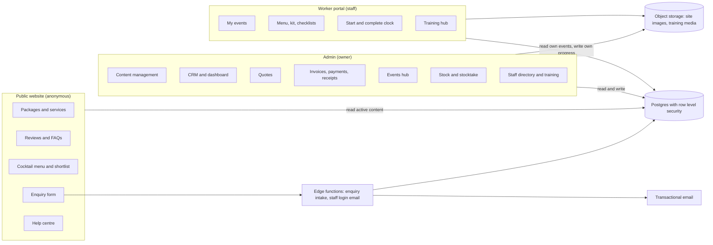
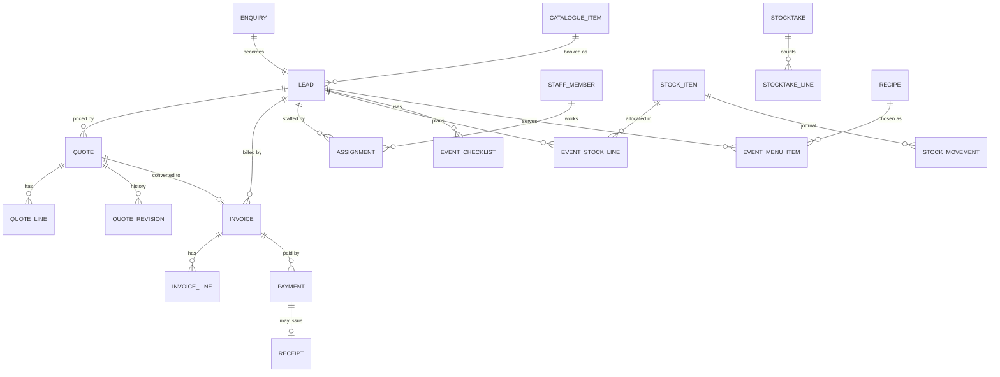
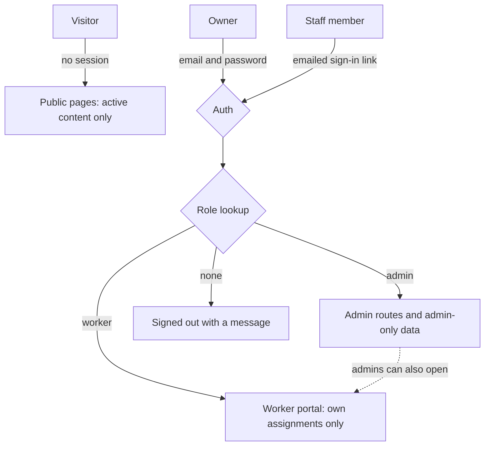

# Architecture

ByJoseM is a single-page React app installed as a PWA, talking directly to a managed Postgres backend. There is no custom application server. Business rules that must hold no matter which screen calls them live in the database: row level security for who can see what, and a small set of database functions for anything that touches money or stock.

## Surfaces

One codebase, three audiences, one database.

Notes:

- **The public site is data-driven.** Every section reads rows the owner edits in the admin, filtered to active records. The cocktail shortlist is stored on the customer's device and leaves only as a WhatsApp message they choose to send, so the public site has no anonymous write path except the enquiry form.
- **The enquiry form goes through a server-side function**, which stores the enquiry, sends the customer a confirmation and notifies the owner. A database trigger turns every enquiry into a CRM lead, so nothing needs copying by hand.
- **PDFs are generated in the browser**, inside the admin, and the PDF library is loaded on demand in its own chunk. The public bundle never includes it.

## Data model, high level

Entity names here are descriptive, not the real schema.

The shapes that matter:

- **A lead is the spine.** An event is not a separate record; it is a lead that has been booked. Quotes, invoices, staff, stock, checklists and the menu all hang off it.
- **One catalogue.** Packages and services share one table with a pricing mode (flat, per guest, per hour, per cocktail, on request) and a price in integer cents. One pricing function in the frontend and one set of totals functions in the database read it.
- **Documents snapshot what they were.** Quotes and invoices freeze their line items, the business identity and the VAT settings at the time they were written. Editing the catalogue or the settings never changes a document the customer already has. Edits to a sent document bump a revision number and append the previous version to an audit table.
- **Stock is a ledger plus a count.** Each item has a current stock and a par level. Weekly stocktakes overwrite the count and keep a frozen history. Between counts, confirmed event allocations and returns write to an append-only movement journal. Usage is derived as sent minus returned, never stored.
- **Append-only where history matters.** Quote revisions, invoice revisions, payments and stock movements are journals. Corrections are new rows, not edits.

### Money as text, then cents

Money never travels as a float. Every price field keeps the text exactly as typed and is parsed only when totals are computed, then stored in integer cents. The reasoning is in the locale-safe parsing decision in [decisions.md](decisions.md).

## Auth and roles

- **Two roles.** A role table maps each authenticated user to admin or worker. Two database helpers answer "is this user an admin" and "is this user staff", and every access policy is written in terms of them.
- **The owner signs in with a password; staff never get one.** The owner creates a staff login from the directory with one click. The staff member receives a branded email with a sign-in link, valid for a day, and asks for a new one from the worker sign-in page whenever they need it.
- **Workers see their own events only.** Access follows the assignment: a worker can read an event, its menu and its checklists only while they are assigned to it, and can only update their own progress on it. They cannot read other customers' events.
- **The frontend guards are convenience, not security.** Admin and worker routes check the role before rendering, but the same rules are enforced again by the database, so a crafted request gets the same answer as the UI.

More detail on how this is enforced and verified is in [security.md](security.md).
